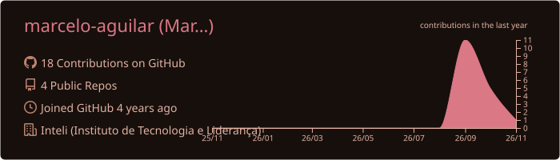
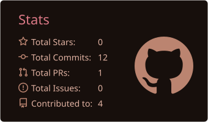
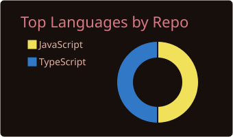
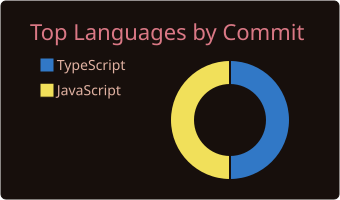

 

## About

I'm a Software Engineering student at [Inteli](https://www.inteli.edu.br/) in São Paulo, on a full scholarship. I've always been driven by curiosity and by wanting to understand how things work, technology most of all.

For me, programming is a way of thinking. I like taking a messy problem apart, trying a few approaches, getting some of them wrong, and ending up with something that actually works. Inteli is project-based: every ten weeks my team takes on a problem from a real partner, and so far that has meant an accessible game, a web app used at a live event and a machine learning model.

I haven't settled on a single path yet. Right now I'm exploring full-stack development, data and machine learning, and cybersecurity, and I see that exploration as part of becoming a well-rounded engineer. I want to work on things that challenge me, next to people I can learn from. Technology keeps changing, and I want to keep growing with it.

<table>
  <tr>
    <td><b>Education</b></td>
    <td>B.S. in Software Engineering, Inteli (2026 to 2029), full scholarship</td>
  </tr>
  <tr>
    <td><b>Recognition</b></td>
    <td>Silver medal at the 16th Brazilian Public Schools Math Olympiad (OBMEP, 2022)</td>
  </tr>
  <tr>
    <td><b>Languages</b></td>
    <td>Portuguese (native), English (advanced), Spanish (intermediate)</td>
  </tr>
  <tr>
    <td><b>Looking for</b></td>
    <td>A software engineering internship</td>
  </tr>
</table>

## Projects

Built in ten-week team projects at Inteli, each one with a real partner.

| Project | Partner | What it does | Stack |
| --- | --- | --- | --- |
| **[PrediDiesel](https://g04-e862d3.pages.git.inteli.edu.br/)** | Cocamar | Predicts when each cooperative member will order diesel next and how much, so the sales team can call them before it turns into an emergency order. Trained on more than 65,000 orders. | Python, Pandas, scikit-learn |
| **[Stamina](https://inteli-stamina.vercel.app/)** | Red Bull | Replaced the race officials' paper clipboards at Red Bull 24 Horas with a tablet app: near real-time scoreboard, auditable history and offline sync. | Node.js, TypeScript, Supabase, PostgreSQL, Jest |
| **[TimeRush](https://graduacao.pages.git.inteli.edu.br/2026-1a/t27/g05/)** | Unifesp | History quiz game for high school students with low vision and motor impairments, playable with eye movement alone through an eye tracker. | JavaScript, Phaser |

On my own time I built a [3D portfolio](https://github.com/marcelo-aguilar/Portif-lio-3D) with React and three.js, where the cursor is a lamp that lights the scene in real time. You can [see it live](https://portifolio-pessoal-kohl.vercel.app).

## Stack

<table>
  <tr>
    <td><b>Languages</b></td>
    <td></td>
  </tr>
  <tr>
    <td><b>Frontend</b></td>
    <td></td>
  </tr>
  <tr>
    <td><b>Backend and databases</b></td>
    <td></td>
  </tr>
  <tr>
 <td><b>Data and ML</b></td>
<td>
  
  
  
  
</td>
  </tr>
  <tr>
    <td><b>Tools</b></td>
    <td></td>
  </tr>
</table>

## GitHub activity

  
  
  

## Let's talk

I'm looking for a software engineering internship. If my work makes sense for your team, reach me on [LinkedIn](https://www.linkedin.com/in/marcelo-aguilar-/) or at [marceloaguilargta@gmail.com](mailto:marceloaguilargta@gmail.com).
